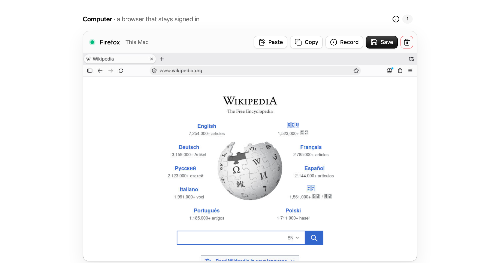

# Computer

A Firefox that stays signed in, in a small Linux VM on your Mac, that you and your agents can drive.



- **Signed in, for good.** Each computer keeps its own Firefox profile on your Mac. Sign in once, press Save, and
  it comes back with its sign-ins and tabs. Sites see your own IP, so there are fewer sign-in checks than from a cloud
  browser.
- **Yours to watch.** The page shows the screen live (noVNC). ⌘C, ⌘V and ⌘A work in it, and copy and paste go both
  ways.
- **An SDK for agents.** `screenshot`, `leftClick`, `write`, `press`, `scroll`, tabs and more, with the same method
  names as [E2B's Desktop SDK](https://e2b.dev/docs/desktop), from TypeScript or the command line.
- **Record, then hand over.** Press Record, do a task, and Finish. Each step is saved with a screenshot as a list
  an agent can read and follow. Passwords are never recorded.

It runs on [Apple's `container`](https://github.com/apple/container): each computer is its own lightweight VM, not a
process sharing your Mac.

## Requirements

- A Mac with Apple silicon, on macOS 26 or later
- [`container`](https://github.com/apple/container/releases) (tested with 1.5)
- [Bun](https://bun.sh) 1.3 or later

## Start

```sh
git clone https://github.com/openwork-africa/computer
cd computer
bun install
bun run start          # builds the page and serves it on http://127.0.0.1:41800
```

Open http://127.0.0.1:41800 and press **Start**. The first start builds the image (Debian, Firefox; a few
minutes, once). After that a computer starts in about 7 seconds.

## The SDK

```ts
import { Computer } from "@openwork/computer"; // in this repo: "./src/sdk.ts"

const pc = await Computer.connect();        // the running one, or Computer.connect("computer-1234abcd")
await pc.open("https://example.com");
await pc.leftClick(512, 300);
await pc.write("hello");
await pc.press("enter");
await Bun.write("screen.png", await pc.screenshot());

await pc.switchTab("mail");                 // by part of its title or address, or by index
await pc.save();                            // shut down, keeping sign-ins and tabs
```

| | |
|---|---|
| Computers | `Computer.create(label?)`, `Computer.connect(id?)`, `Computer.list()`, `save()`, `resume()`, `kill()` |
| Screen | `screenshot()`, `getScreenSize()`, `getCursorPosition()`, `getWindowTitle()` |
| Mouse | `leftClick(x, y)`, `doubleClick`, `rightClick`, `middleClick`, `moveMouse`, `drag(from, to)`, `scroll(dir, n)` |
| Keyboard | `write(text)`, `press("ctrl+l")`, `press(["ctrl", "shift", "t"])` |
| Browser | `open(url, { newTab })`, `getUrl()`, `tabs()`, `switchTab(n \| text)`, `newTab`, `nextTab`, `prevTab`, `closeTab` |
| Clipboard | `getClipboard()`, `setClipboard(text)`, `copy()` |
| Recording | `record.start()`, `record.note(text)`, `record.finish(name)`, `record.status()`, `record.discard()` |

The screen is 1024×640, and screenshot pixels are click coordinates.

### From the command line

```sh
bun computer list
bun computer screenshot screen.png
bun computer click 512 300
bun computer type "hello"
bun computer key enter
bun computer tabs
bun computer tab mail
bun computer help      # every command
```

`--id computer-1234abcd` picks a computer when more than one is running.

## Recordings

A finished recording is a folder in `~/.openwork-computer/recordings/<name>/`:

```
steps.md      # one line per step, written for an agent to read
steps.json    # the same, with each element's label, selector and screen position
0001.jpg …    # the screen as each step was done
```

```
1. Clicked search field "Search Wikipedia" at 512,590 on www.wikipedia.org (0001.jpg)
2. Typed "Nairobi" into search field "Search Wikipedia" (0002.jpg)
3. Pressed Enter in search field "Search Wikipedia" (0003.jpg)
4. Page opened (form_submit): https://en.wikipedia.org/wiki/Nairobi (0004.jpg)
5. Note from the person recording: open the first result (0005.jpg)
```

## How it works

```
web/ (React)  ──HTTP──▶  src/server.ts  ──▶  src/sdk.ts ──▶ ComputerService · RecordingService · Desktop
   │                                                              │
   └──── noVNC websocket ────────────────────────────▶  container VM (image/): Xvfb · openbox · Firefox
                                                         x11vnc → websockify :6080 · recorder add-on
```

| Path | What it is |
|---|---|
| `src/runtime.ts` | Adapter over the `container` command line; every computer name is checked first |
| `src/computers.ts` | Facade for making, saving, resuming and deleting computers |
| `src/desktop.ts` | What can be done on a running screen (xdotool, ImageMagick, xclip) |
| `src/recordings.ts` | Recording, with one narrator per kind of step (Strategy) |
| `src/sdk.ts` | `Computer`: the public API, used by the CLI and the server alike |
| `src/cli.ts`, `src/server.ts` | Command tables: one entry per command or route |
| `image/` | The VM: Debian, Firefox, the boot script and the recorder add-on |
| `web/` | The page: Vite, React 19, Tailwind 4 and [Wirekyt UI](https://ui.wirekyt.com) |

**Where things are kept:** `~/.openwork-computer/` (set `COMPUTER_HOME` to move it). That folder holds
`computers.json`, `profiles/<id>/` (each Firefox profile) and `recordings/`. Everything in it is readable by your
user only. **A profile holds live sign-ins**: treat it like a password.

**Security:** the server and every screen listen on 127.0.0.1 only. Each boot sets a new screen password. The API
answers only its own page. The VM sees only its own profile folder.

## Develop

```sh
bun run dev            # the server, with the page on Vite (http://localhost:5173)
bun test
bun run typecheck
bun run image          # rebuild the VM image after changing image/
```

Saved computers pick up a rebuilt image on their next Resume.

## License

MIT. noVNC is MPL-2.0; Firefox is Mozilla's.
