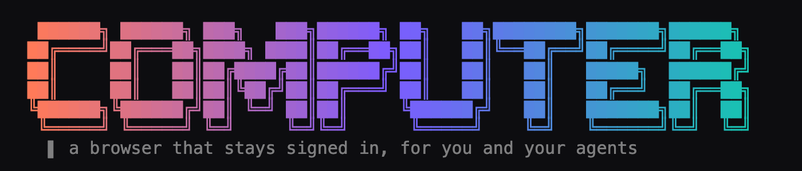
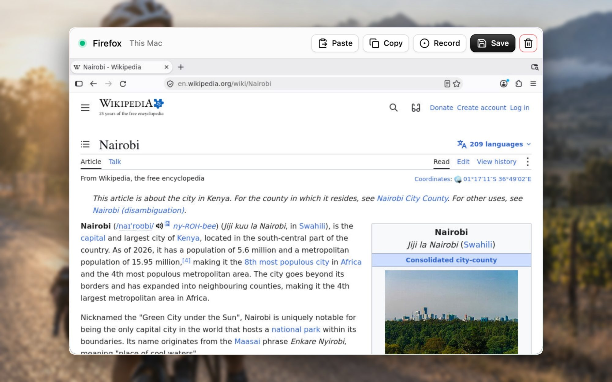

<p align="center"></p>

A Firefox that stays signed in, in a small Linux VM on your Mac, that you and your agents can drive.
**[worklyn.com/computer](https://worklyn.com/computer)**



- **Signed in, for good.** Each computer keeps its own Firefox profile on your Mac. Sign in once, press Save, and
  it comes back with its sign-ins and tabs. Sites see your own IP, so there are fewer sign-in checks than from a cloud
  browser.
- **Yours to watch.** The page shows the screen live. ⌘C, ⌘V and ⌘A work in it, and copy and paste go both ways.
- **Agents can drive it.** `screenshot`, `click`, `type`, `key`, tabs and more, from the command line or TypeScript.
- **Record, then hand over.** Press Record, do a task, and Finish. Each step is saved with a screenshot as a list an
  agent can read and follow. Passwords are never recorded.

Each computer is its own lightweight VM ([Apple's `container`](https://github.com/apple/container)), not a process
sharing your Mac.

## Install

You need a Mac with Apple silicon (an M1 or later:  → About This Mac shows "Chip: Apple M…") on macOS 26 or later.

1. Install Apple's `container`. On its [releases page](https://github.com/apple/container/releases), download
   `container-<version>-installer-signed.pkg` and open it.
2. Open **Terminal** (⌘Space, type Terminal) and paste:

   ```sh
   curl -fsSL https://github.com/openwork-africa/computer/releases/latest/download/install.sh | sh
   ```

   It installs the `computer` command. If it says the folder is not on your PATH, paste the line it prints, too.
   Run the same install line again any time to update.

## Use it

```sh
computer serve
```

1. Leave that Terminal window open (it is the page's server). Open **http://127.0.0.1:41800** in your browser.
2. Press **Start**. The very first start builds the computer (Debian and Firefox; a few minutes, once). After that a
   computer starts in about 7 seconds.
3. Click into the screen, go to a site, and sign in as you would anywhere. Tick "stay signed in" where a site offers
   it.
4. Leave it running while you or an agent use it. Press **Save** when you are done for the day: it shuts the computer
   down and keeps its sign-ins and tabs. **Resume** brings it back.

The **ⓘ** button lists your computers and recordings. A computer uses up to 2 GB of memory while it runs and none
while saved.

## For agents

Paste this to your agent (Claude Code, Codex, Cursor or any agent that can run commands and view images):

```text
Add the Computer skill: download
https://raw.githubusercontent.com/openwork-africa/computer/main/skills/computer/SKILL.md
and save it as ~/.claude/skills/computer/SKILL.md (or wherever your skills or rules live). Then read it, and use
my Computer whenever I ask you to do something on a website as me.
```

[The skill](skills/computer/SKILL.md) teaches the loop: **look, act, look again**.

```sh
computer list                          # each line: <id>  <state>  <label>; one must be "running"
computer screenshot /tmp/screen.png    # look: a 1024x640 PNG; its pixels are click coordinates
computer click 512 300                 # act
computer type "hello"                  # into whatever is focused (click the field first)
computer key enter                     # also: escape, tab, ctrl+l, pagedown, ctrl+shift+t…
computer open https://example.com      # go to an address (--new-tab for a new tab)
computer tabs                          # open tabs; * marks the one in front
computer tab mail                      # bring a tab forward by part of its title or address
computer title                         # the page's title, as text (also: computer url)
computer logs                          # the sites' console errors, when a page misbehaves
computer help                          # every command
```

The skill also says when to stop and ask: before passwords, payments, sending, or deleting. It also covers following a
task someone [recorded](#recordings).

The same in TypeScript ([`src/sdk.ts`](src/sdk.ts)) is below.

```ts
import { Computer } from "./src/sdk.ts"; // from a clone of this repo, run with Bun

const pc = await Computer.connect();      // the running one, or Computer.connect("computer-1234abcd")
await pc.open("https://example.com");
await pc.leftClick(512, 300);
await pc.write("hello");
await pc.press("enter");
await Bun.write("screen.png", await pc.screenshot());
await pc.switchTab("mail");
await pc.save();                          // shut down, keeping sign-ins and tabs
```

| | |
|---|---|
| Computers | `Computer.create(label?)`, `Computer.connect(id?)`, `Computer.list()`, `save()`, `resume()`, `kill()` |
| Screen | `screenshot()`, `getScreenSize()`, `getCursorPosition()`, `getWindowTitle()` |
| Mouse | `leftClick(x, y)`, `doubleClick`, `rightClick`, `middleClick`, `moveMouse`, `drag(from, to)`, `scroll(dir, n)` |
| Keyboard | `write(text)`, `press("ctrl+l")`, `press(["ctrl", "shift", "t"])` |
| Browser | `open(url, { newTab })`, `getUrl()`, `tabs()`, `switchTab(n \| text)`, `newTab`, `nextTab`, `prevTab`, `closeTab` |
| Clipboard | `getClipboard()`, `setClipboard(text)`, `copy()` |
| Recording | `record.start()`, `record.note(text)`, `record.finish(name)`, `record.status()`, `record.discard()` |

## Recordings

Press **Record** in the page and do the task. Type a note whenever the reason matters ("only jobs from this week").
Then name it and press **Finish**. The recording is saved in `~/.openwork-computer/recordings/<name>/`:

```
steps.md      # one line per step, written for an agent to read
steps.json    # the same, with each element's label, selector and screen position
0001.jpg …    # the screen as each step was done
```

```
1. Clicked search field "Search Wikipedia" at 512,590 on www.wikipedia.org (0001.jpg)
2. Typed "Nairobi" into search field "Search Wikipedia" (0002.jpg)
3. Pressed Enter in search field "Search Wikipedia" (0003.jpg)
4. Page opened (form_submit): https://en.wikipedia.org/wiki/Nairobi (0004.jpg)
5. Note from the person recording: open the first result (0005.jpg)
```

## Where things are kept

Everything is in `~/.openwork-computer/`, which only your Mac user can read. Set `COMPUTER_HOME` to move it.

| | |
|---|---|
| `profiles/<id>/` | Each computer's Firefox profile. **It holds live sign-ins: treat it like a password.** |
| `recordings/` | Your recordings |
| `computers.json` | The list of computers |
| `app/` | The installed app |

**Security.** The page and every screen listen on 127.0.0.1 only, and each boot sets a new screen password. Only the
page itself can call its API, so other websites cannot. Each VM sees only its own profile folder.

## When something is off

| | |
|---|---|
| `container: …` errors | Check that `container` is installed and run `container system start` |
| Port 41800 in use | `PORT=41900 computer serve` |
| "No computer is running" | Start one in the page or with `computer create`; resume a saved one from the ⓘ list or with `computer --id <id> resume` |
| The screen is black or frozen | Reload the page; the computer keeps running |
| A site's button stays grey, or sign-in goes nowhere | `computer logs` shows the site's errors. Reloading the site's tab often clears a failed check |
| Signed out after Save | That site's sign-in did not ask to be remembered. Tick "stay signed in" or "remember me" when signing in |

**Remove everything:** delete your computers in the page, then `rm -rf ~/.openwork-computer ~/.local/bin/computer`.

## Develop

```sh
git clone https://github.com/openwork-africa/computer && cd computer
bun install
bun run start          # builds the page, then serves it like `computer serve`
bun run dev            # the server, with the page on Vite at http://localhost:5173
bun test
bun run typecheck
bun run image          # rebuild the VM image after changing image/ (saved computers pick it up on Resume)
bun run release        # the binary and tarball that install.sh downloads
```

A `v*` tag publishes a release ([`.github/workflows/release.yml`](.github/workflows/release.yml)).

```
web/ (React)  ──HTTP──▶  src/server.ts  ──▶  src/sdk.ts ──▶ ComputerService · RecordingService · Desktop
   │                                                              │
   └──── noVNC websocket ────────────────────────────▶  container VM (image/): Xvfb · openbox · Firefox
                                                         x11vnc → websockify :6080 · recorder add-on
```

| Path | What it is |
|---|---|
| `src/runtime.ts` | Adapter over the `container` command line; every computer name is checked first |
| `src/computers.ts` | Facade for making, saving, resuming and deleting computers |
| `src/desktop.ts` | What can be done on a running screen (xdotool, ImageMagick, xclip) |
| `src/recordings.ts` | Recording, with one narrator per kind of step (Strategy) |
| `src/sdk.ts` | `Computer`: the public API, used by the CLI and the server alike |
| `src/cli.ts`, `src/server.ts` | Command tables: one entry per command or route |
| `image/` | The VM: Debian, Firefox, the boot script and the recorder add-on |
| `web/` | The page: Vite, React 19, Tailwind 4 and [Wirekyt UI](https://ui.wirekyt.com) |

## License

MIT. noVNC is MPL-2.0; Firefox is Mozilla's.
